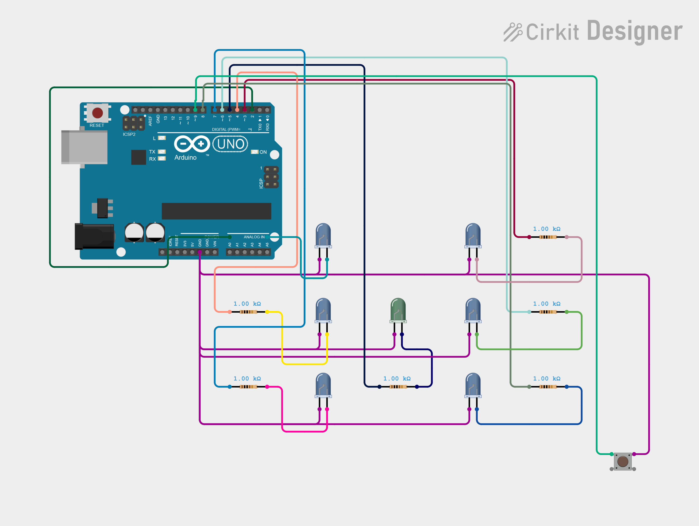
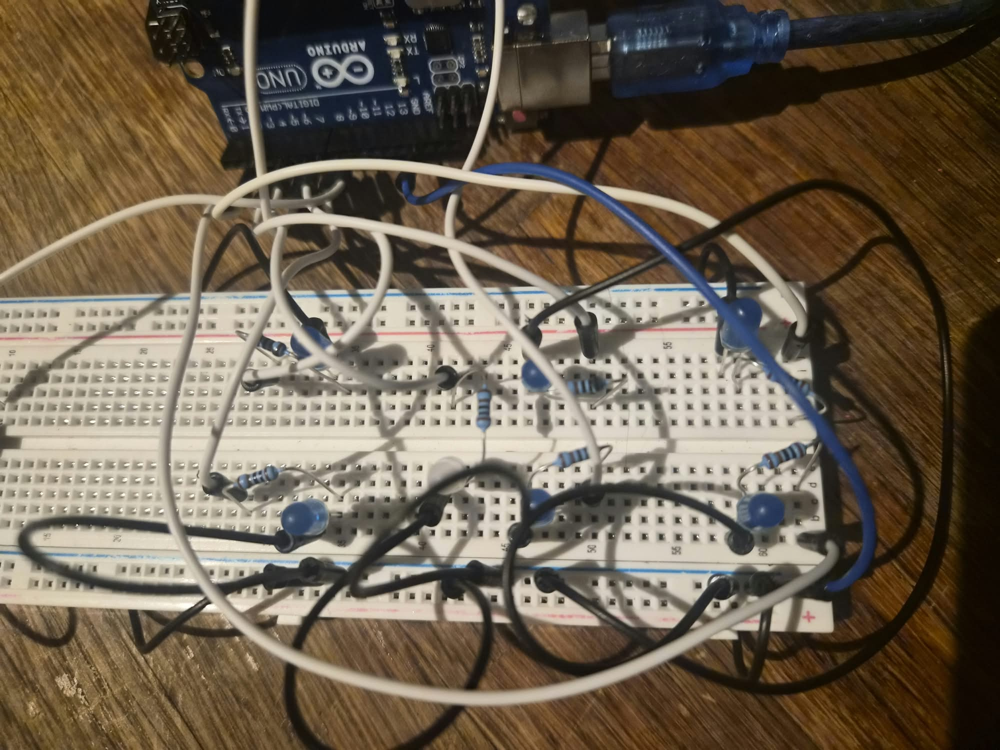

# Electronic Dice

An **Arduino-powered electronic dice**: press a button to generate a pseudo-random number from **1 to 6**, then light up the LEDs to display the corresponding face of a dice.

This project was built in two stages:

1. **Breadboard prototype** — built with an Arduino Uno to test the wiring and code.
2. **Soldered version** — built on perfboard with a removable Arduino Nano and powered by a 9 V battery.

## Components

### Breadboard prototype

- Arduino Uno
- 7 LEDs
- 7 current-limiting resistors (**1 kΩ** each)
- 1 momentary push button
- Breadboard and jumper wires

### Soldered version

- Arduino Nano (classic 5 V model)
- 2 male header strips for the Nano
- 2 female header strips soldered to the perfboard (so the Nano can be removed)
- 7 LEDs
- 7 current-limiting resistors (**1 kΩ** each)
- 1 momentary push button
- Double-sided perfboard with individual solder pads
- 30 AWG hookup wire for connections
- Soldering equipment
- 9 V battery and battery clip

<h2>🔌 Pin Connections</h2>

<table>
  <tr>
    <td width="55%" align="center">
      
    </td>
    <td width="45%" valign="middle">

| Component | Arduino Pin |
| --- | --- |
| Top-left LED | D2 |
| Top-right LED | D3 |
| Middle-left LED | D4 |
| Center LED | D5 |
| Middle-right LED | D6 |
| Bottom-left LED | D7 |
| Bottom-right LED | D8 |
| Roll button | D9 |

  </tr>
</table>


The button uses `INPUT_PULLUP`, so it is connected between **D9 and GND**. Each LED has **its own series resistor**. Pin **A0** is left unconnected and used for the pseudo-random seed with `randomSeed(analogRead(A0))`.

## 1. Breadboard Prototype

The first version uses an **Arduino Uno** and a breadboard. It lets me test the connections and all six dice faces before soldering the final circuit.

### Prototype Photo

<p align="center">
  
</p>

### Prototype Video

https://github.com/user-attachments/assets/656e8add-bde9-4ebc-b047-4bc877f6e4bf

### How It Works

1. The Arduino waits for the button to be pressed.
2. It picks a number using `random(1, 7)` (1 through 6 inclusive).
3. It turns off all LEDs to clear the previous result.
4. A `switch` statement turns on the LEDs for the selected dice face.
5. It waits for the button to be released before accepting another roll.

## 2. Soldered Version

The final version is **assembled and working** on perfboard. I replaced the Arduino Uno with a more compact **Arduino Nano** and soldered the LED, resistor, and button connections.

### Soldered Version Photo

<p align="center">
  
  
  
</p>

### Soldered Version Video


### Assembly

- I soldered **male pin headers** to the Arduino Nano.
- I soldered **female headers** to the perfboard so that the Nano can be **unplugged and reused in other projects**.
- I installed the **7 LEDs** in a dice-face layout.
- I added a **separate 1 kΩ resistor for each LED** to limit the current and keep the brightness comfortable.
- I used **30 AWG wire** to make the connections on the perfboard.
- I connected the LED cathodes and other ground connections to a **common GND connection**.
- I connected the push button between **D9 and GND**.
- I connected a **9 V battery clip** to power the final build without USB.

### Battery Power

The classic 5 V Arduino Nano is powered through its **VIN** and **GND** pins:

<table>
  <tr>
    <td width="55%" align="center">
      
    </td>
    <td width="45%" valign="middle">

| Component | Nano Pin |
| --- | --- |
| Top-left LED | D2 |
| Top-right LED | D3 |
| Middle-left LED | D4 |
| Center LED | D5 |
| Middle-right LED | D6 |
| Bottom-left LED | D7 |
| Bottom-right LED | D8 |
| Roll button | D9 |
| Batterie Red (+9 V) | VIN |

  </tr>
</table>

There is currently **no ON/OFF switch**. The battery must be disconnected when the dice is not in use to prevent unnecessary battery drain.

## Arduino Code

The sketch uses `pinMode()`, `digitalRead()`, `digitalWrite()`, `random()`, `randomSeed()`, and a `switch` statement to control the LEDs.

## 📁 Project Structure

```text
.
├── README.md
├── Dice.ino
├── images/
│   ├── circuit-image.png
│   ├── prototype-1.jpg
│   ├── prototype-2.jpg
│   ├── prototype-3.jpg
│   ├── soldered-1.jpg
│   ├── soldered-2.jpg
│   └── soldered-3.jpg
└── videos/
    └── prototype.mp4
    └── solered-prototype.mp4
```

## What I Learned

This project taught me a lot about **electronics, Arduino programming, and building real hardware**, especially when moving from a breadboard prototype to a permanent soldered circuit.

### Electronics and soldering

- Transferring a working circuit from a breadboard to a perfboard.
- Soldering LEDs, resistors, wires, and connectors.
- Creating and testing a common GND connection.
- Using a multimeter to check connections and troubleshoot problems.
- Powering an Arduino Nano with a 9 V battery through **VIN**.
- Keeping the Nano removable with male headers and female sockets, so I can reuse it in other projects.

### Arduino programming

- Reading a button using `INPUT_PULLUP`.
- Controlling multiple LEDs with digital outputs.
- Using pseudo-random numbers to simulate rolling a die.
- Turning a number into the corresponding LED pattern.

### Challenges and lessons

**My solder joints are not perfect yet.** This was one of my first soldering projects, and some connections could definitely be cleaner. The wiring could also be more organized and compact.

But **the circuit works**, and building it helped me become more comfortable with soldering, checking connections, and troubleshooting hardware. I'm happy with the result and know what I want to improve next time.

> **Biggest takeaway:** A project doesn't have to look perfect to be a valuable learning experience. Building, testing, making mistakes, and improving are all part of the process.

**Made with Arduino, a soldering iron, and a lot of learning. **
